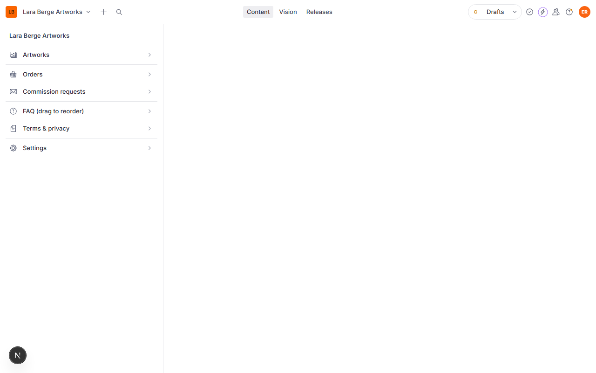
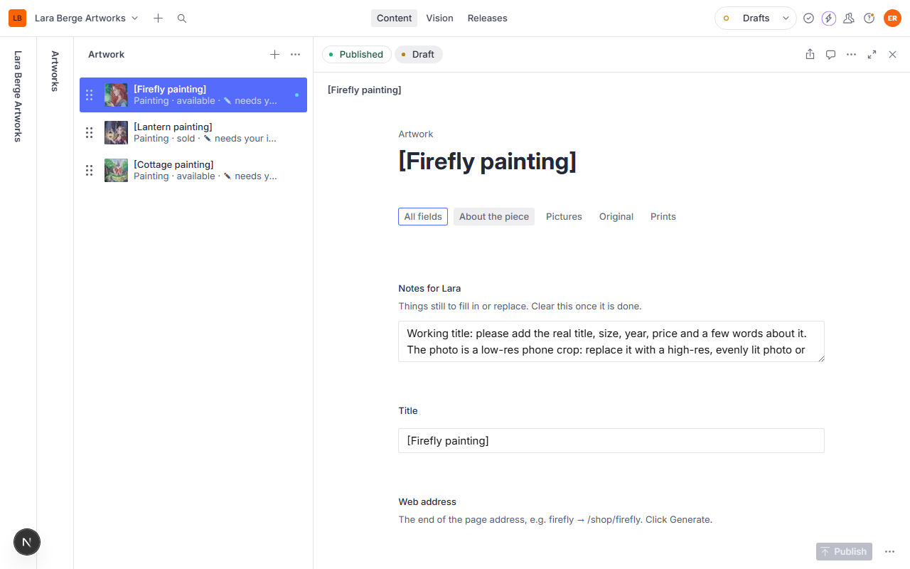
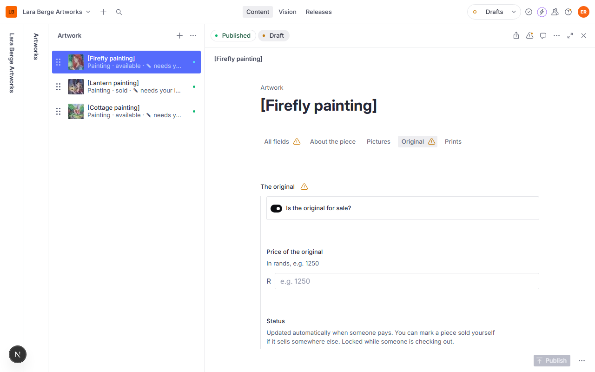
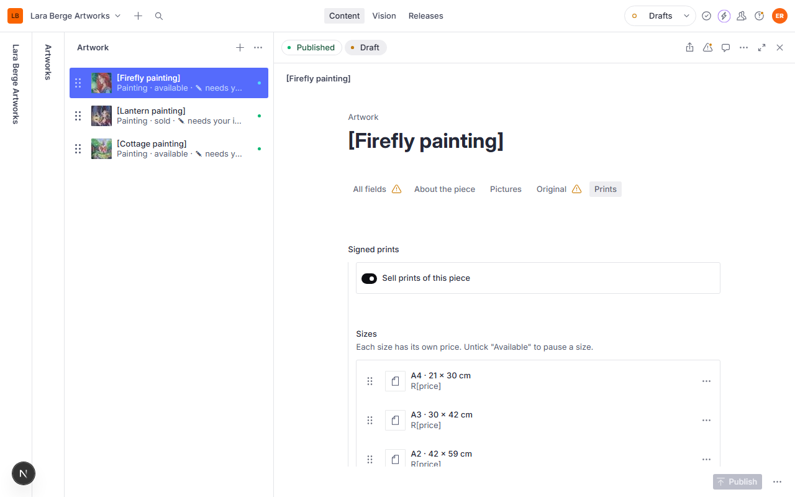
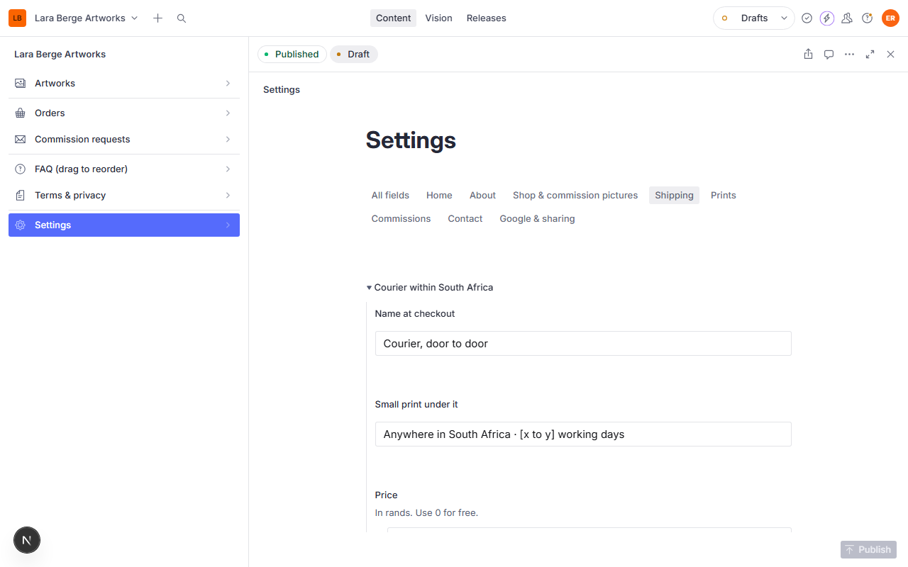
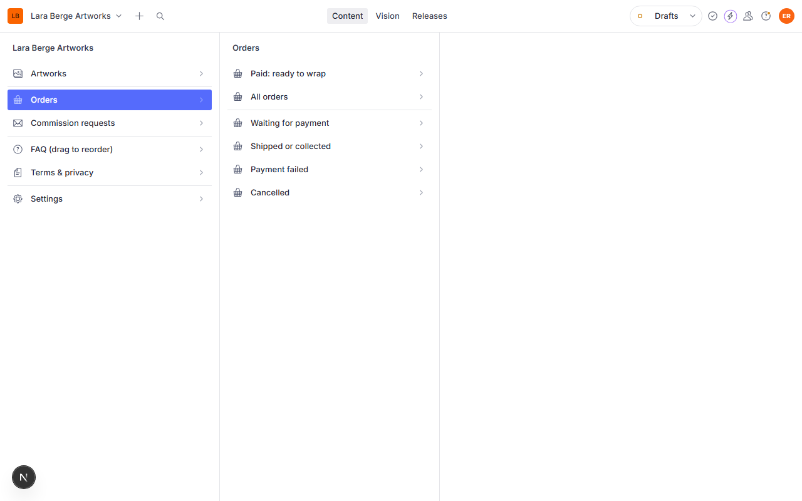
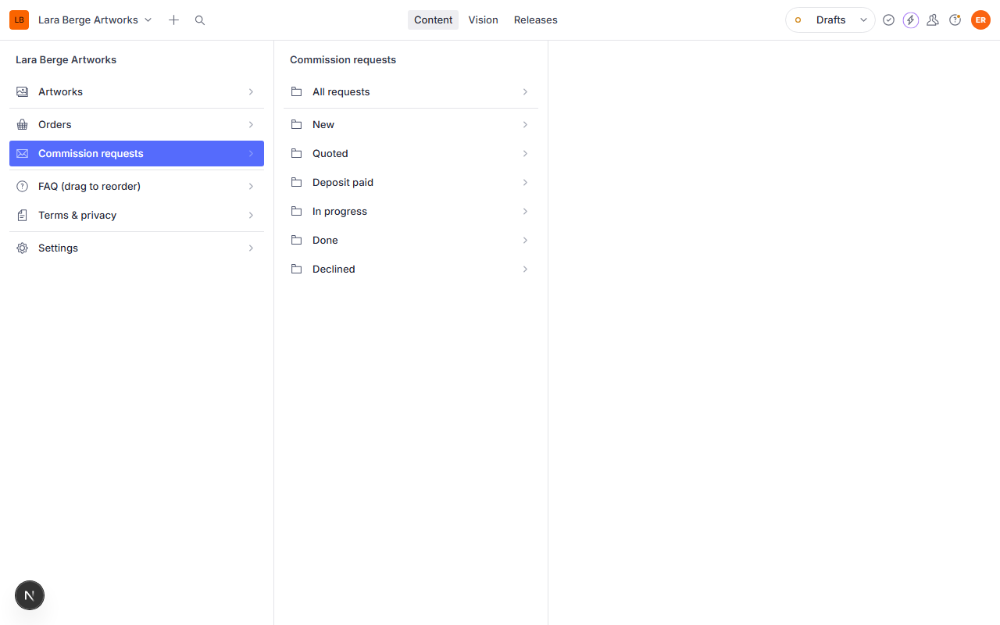

# Your website: how to look after it

Hi Lara! Everything on the website (paintings, prices, prints, the FAQ, shipping costs) lives in one place called the **Studio**. You change things there, press **Publish**, and the website updates within a few seconds. You can't break the design from the Studio, so feel free to explore.

## Opening the Studio

Go to **your website address followed by `/studio`** (for example `laraberge.co.za/studio`) and log in with the Google account Max set up for you. It works on your phone too, but it's nicer on a laptop.

The menu on the left:

- **Artworks**: your paintings and digital illustrations
- **Orders**: everything people have bought
- **Commission requests**: ideas people send through the commission form
- **FAQ**: the questions and answers
- **Terms & privacy**: the small print pages
- **Settings**: everything else (home page, shipping prices, commission prices, your email and Instagram)

**One thing to remember:** changes only go live when you press the green **Publish** button at the bottom right. Until then they're saved as a draft that only you can see.

## Things marked with [square brackets]

Anything in [square brackets], like `[Cottage painting]` or `[x to y] working days`, is a placeholder waiting for your words. They show on the website exactly like that until you replace them, so it's easy to spot what's left. There's a full list in [PLACEHOLDERS.md](PLACEHOLDERS.md).

Each artwork also has a **Notes for Lara** box at the top saying what's still needed. When you've done it, clear the box. **Artworks → Still needs your input** lists every piece that still has notes.

## Adding a new painting

1. Go to **Artworks → Paintings** and press the **+** at the top of the list.
2. Fill in the **About the piece** tab:
   - **Title**, then press **Generate** next to *Web address*.
   - **Kind of work**: Oil painting.
   - **Year**, **Medium** (e.g. "Oil on stretched canvas") and **Size of the original** (e.g. "40 × 50 cm").
   - **A few words about it**: the story behind it.
   - Tick **Show on the home page** if it should appear under "New paintings".
3. On the **Pictures** tab, add the **Main picture** (as big and evenly lit as you have it) and describe it in one sentence. That description is read aloud to people who can't see the picture, and Google reads it too. Add up to three **Close-ups** if you like.
4. Optionally click on the picture and drag the little circle onto the most important part (a face, the firefly). The website keeps that spot in view when it crops the picture into a frame.
5. Press **Publish**.

**Reordering:** in the Paintings or Digital illustrations list, drag pieces up and down by the dotted handle. The gallery and shop follow the same order.

## Selling the original

On the **Original** tab:

- Switch on **Is the original for sale?**
- Type the **Price** in rands, just the number, e.g. `4500`.
- **Status** changes by itself when someone pays: *Available* → *Reserved* (while they're paying, up to 30 minutes) → *Sold*. If you sell a painting somewhere else (at a market, say), set it to **Sold** yourself. While a piece shows *Reserved* the status is locked, because someone is in the middle of paying.

Sold paintings stay on the website with a "sold" label and a link to their prints, so people can still fall in love with them.

## Prints and their prices

On the **Prints** tab:

- **Sell prints of this piece** turns prints on or off for that artwork.
- Each size (A4, A3, A2) has its own **Price** in rands. Click a size to open it.
- Untick **Available** on a size to pause just that size (if you've run out of paper, say).

A piece can't be bought until it has a price. Until then the website shows "R[price]" and the Add to cart button stays switched off.

## Changing shipping prices and delivery times

**Settings → Shipping** has the three delivery options people choose from at checkout: courier in South Africa, collecting from you, and international. For each you can change the name, the small print and the price. Below them are your dispatch and delivery times, which show on the shop pages and in the FAQ.

The other Settings tabs:

- **Home**: the big picture at the top of the home page and how it moves, the welcome words, and your "Hello, I'm Lara" text and portrait.
- **About**: your story, photo and studio notes.
- **Shop & commission pictures**: which artworks appear on the Shop page doors and the Commissions page.
- **Prints**: paper name and details.
- **Commissions**: starting prices, how long things take, deposit percentage, and the size and budget choices on the form.
- **Contact**: your email, Instagram handle, reply time and city.
- **Google & sharing**: how the site looks in Google and when someone shares a link.

## When someone buys something

You'll get an email for each new order with everything you need: what they bought, their address, any note, and whether it's a gift (leave the price out of the parcel).

In the Studio, **Orders → Paid: ready to wrap** lists everything waiting to be packed.

Open an order to see the details. Once the parcel has gone (or been collected), set **Status** to **Shipped or collected** and press **Publish**. You can keep **Your private notes** on each order, like a tracking number or "posted Tuesday". Everything else in an order is locked so it can't be changed by accident.

Orders that say **Waiting for payment** are people who went to PayFast but haven't paid (or are paying right now). Ones that are never paid close by themselves after half an hour, and any reserved painting goes back on sale.

## Commission requests

When someone sends an idea through the commission form you get an email (with their reference photos), and it appears under **Commission requests → New**.

Open a request and move its **Status** along as you go: *New* → *Quoted* → *Deposit paid* → *In progress* → *Done* (or *Declined*). Use **Your private notes** for the quote, dates and anything else to remember. The lists on the left are grouped by status, so you can see at a glance what needs a reply.

The deposit itself is paid through a payment link you create in your PayFast dashboard and email to the customer.

## The FAQ

**FAQ** lists every question. Click one to edit it, drag them to reorder, or press **+** to add a new one. Each question has a **Section** (shipping, originals & prints, commissions, payments & returns) and a **Show on** setting: the FAQ page, the "Good to know" part of the Commissions page, or both.

## If something looks wrong

- **I published but the website hasn't changed:** wait ten seconds and reload the page. If it still hasn't, tell Max.
- **I deleted something by mistake:** open the document, click the three dots at the top right and choose *History* to restore an earlier version.
- **A picture is cropped badly:** click the picture in the Studio and drag the circle onto the important part.
